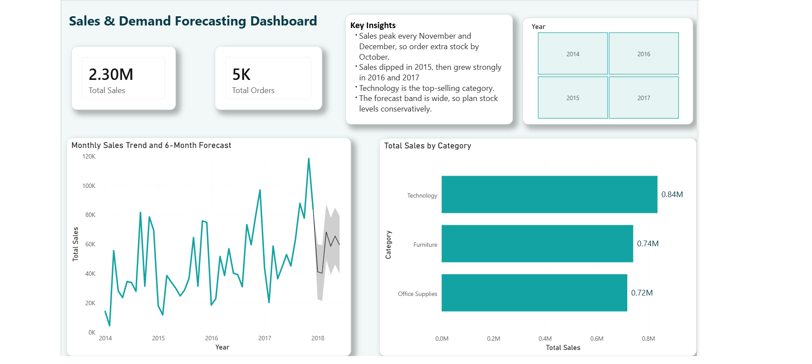

# Sales & Demand Forecasting Dashboard

**Internship:** Future Interns, Machine Learning Track, Task 1

## About
A Power BI dashboard combined with a Python forecasting model that analyses Superstore sales (2014-2017) and forecasts future sales for business planning.

## Dataset
Superstore Sales Dataset (Kaggle): https://www.kaggle.com/datasets/vivek468/superstore-dataset-final

## What I did

### Power BI Dashboard
- Cleaned the data in Power Query (fixed date formats with locale settings, removed duplicates and blank rows)
- Built a date table and time-based fields (year, month, quarter, month-start)
- Linked the date table to the orders table
- Created a monthly sales trend line chart with a 6-month forecast (95% confidence interval, seasonality 12)
- Built KPI cards (Total Sales, Total Orders), a category breakdown chart, and a year slicer
- Designed the dashboard with a consistent teal colour theme, rounded tiles and shadows

### Python Model (Jupyter Notebook)
- Loaded and cleaned the same dataset in Python (Pandas)
- Aggregated daily orders into monthly sales totals
- Engineered time-based features (month number, month of year, year)
- Split the data by time: trained on 2014-2016 (36 months), tested on 2017 (12 months, unseen data)
- Trained a Random Forest Regressor to predict monthly sales
- Evaluated the model using MAE, RMSE, R², and MAPE
- Plotted actual vs predicted sales for 2017
- Exported month-by-month predictions to `forecast_results.csv`

## Model Evaluation

A Random Forest model was trained on monthly sales from 2014-2016 and tested on 2017 (unseen data).

| Metric | Value | Meaning |
|---|---|---|
| MAE | ₹11,705 | On average, the forecast is off by about ₹11,705 per month |
| RMSE | ₹13,954 | Slightly higher than MAE, meaning a few months had larger errors |
| R² | 0.71 | The model explains about 71% of the variation in monthly sales |
| MAPE | 20.2% | The forecast is typically within about 20% of actual sales |

**Business interpretation:** The model captures the overall seasonal pattern (lower sales early in the year, rising toward the end), but it consistently underestimates the sharp November-December spike, missing it by roughly ₹20,000-30,000 in peak months. The forecast is reliable for general monthly planning and budgeting, but during the holiday season a business should add a 20-25% safety buffer above the model's prediction rather than relying on the raw number.

**Recommendation:** Use this forecast as a baseline for monthly planning, and increase safety stock by 20-25% in October-December to avoid stockouts during the peak sales period.

## Key insights
- Sales peak every November and December, so extra stock should be ordered by October
- Sales dipped in 2015, then grew strongly in 2016 and 2017
- Technology is the top-selling category (0.84M), followed by Furniture (0.74M) and Office Supplies (0.72M)
- The forecast confidence band is wide, so stock levels should be planned conservatively
- The Python model confirms this: it misses the holiday peak by 20-30%, so a manual safety buffer is recommended during Q4

## Files
- `Sales_Forecast_Dashboard.pbix` - Power BI dashboard file
- `dashboard_overview.png` - dashboard screenshot
- `Sales_Forecast_Dashboard.pdf` - PDF export of the dashboard
- `sales forecasting.ipynb` - Python notebook (data cleaning, model training, evaluation)
- `forecast_results.csv` - 2017 actual vs predicted sales, month by month

## Tools
Power BI Desktop, Power Query, DAX, Python (Pandas, Scikit-learn, Matplotlib), Jupyter Notebook
